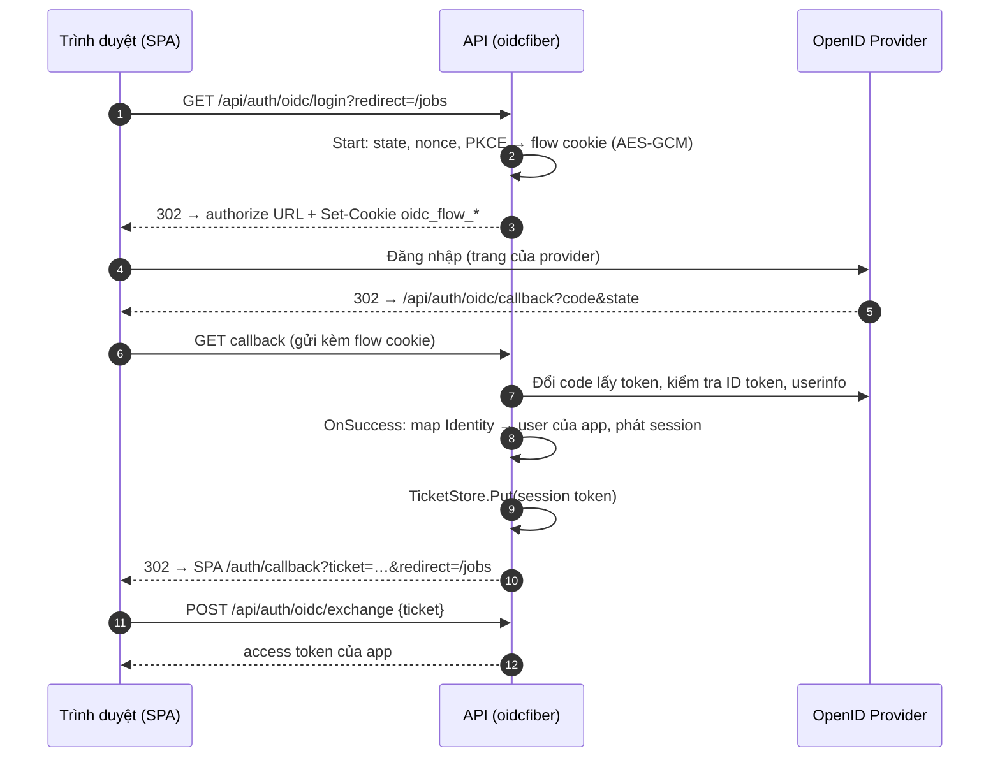

# Cài đặt và wiring

Tài liệu này dành cho người tích hợp `oidcauth` vào một service Go. Phần cấu
hình phía provider (Zitadel...) nằm ở [zitadel/](zitadel/README.md) và
[providers.md](providers.md).

## 1. Luồng tổng quát



Thư viện lo bước 2–7 (và kiểm tra state/nonce/PKCE/chữ ký). App lo
`OnSuccess`: tìm hoặc liên kết user, phát token theo cơ chế sẵn có, rồi trao
token cho SPA qua ticket dùng một lần (token không bao giờ nằm trên URL).

## 2. `Config` ↔ biến env

Cột "Biến env" là quy ước của backend template; app khác có thể đặt tên khác.

| Trường `oidcauth.Config` | Biến env (template) | Ghi chú |
|---|---|---|
| `Issuer` | `AUTH_OIDC_ISSUER` | Phải trùng **chính xác** `issuer` trong `/.well-known/openid-configuration` (không có `/` cuối với Zitadel) |
| `DiscoveryURL` | — | Chỉ khi discovery không nằm ở `<Issuer>/.well-known/openid-configuration` |
| `ClientID` | `AUTH_OIDC_CLIENT_ID` | |
| `ClientSecret` | `AUTH_OIDC_CLIENT_SECRET` | `client_secret_basic` (tự lùi về `client_secret_post` nếu provider chỉ hỗ trợ cái đó) |
| `ClientKey` + `ClientKeyID` | `AUTH_OIDC_CLIENT_KEY_FILE` | `private_key_jwt`. Template đọc file JSON key của Zitadel (`key`, `keyId`). Không dùng chung với `ClientSecret` |
| `TokenEndpointAuthMethod` | — | Mặc định tự chọn; chỉ đặt khi cần ép một phương thức |
| `RedirectURL` | `AUTH_OIDC_REDIRECT_URL` | URL tuyệt đối của callback, phải đăng ký ở provider |
| `Scopes` | `AUTH_OIDC_SCOPES` | Mặc định `openid profile email`, cách nhau bởi dấu cách |
| — (`WithExtraScopes`) | `AUTH_OIDC_EXTRA_SCOPES`, `AUTH_OIDC_<KEY>_EXTRA_SCOPES` | Scope thêm cho một nút login, vd. `urn:zitadel:iam:org:id:<org>` |
| — (`WithParam`) | `AUTH_OIDC_<KEY>_PARAMS` | Tham số authorize thêm, dạng `k:v,k:v` (vd. `hd:example.com`) |
| `ACRValues`, `RequireACR`, `MaxAge` | — | Yêu cầu mức xác thực / đăng nhập lại; xem README thư viện |
| `CookieSecret` | `AUTH_OIDC_COOKIE_SECRET` | ≥ 32 ký tự: `openssl rand -base64 32`. Đổi giá trị chỉ làm hỏng các login đang dở |
| `CookieName` | — | Mặc định `oidc_flow` |
| `CookiePath` | — (template cố định `/api/auth/oidc/`) | Phải bao phủ path của callback |
| `CookieInsecure` | `AUTH_OIDC_COOKIE_INSECURE` | `true` **chỉ** khi chạy HTTP thuần ở local |
| `FlowTTL` | — | Mặc định 10 phút: thời gian tối đa user đứng ở trang login |
| `SkipUserInfo` | — | Mặc định gọi userinfo và gộp claim |
| `RoleExtractor` | — | Mặc định đọc role Zitadel, rồi `roles` / `groups` |
| `PostLogoutRedirectURL` | `AUTH_OIDC_POST_LOGOUT_REDIRECT_URL` | Template mặc định `${AUTH_FRONTEND_URL}/auth/login`; phải đăng ký ở provider |
| `HTTPClient` | — | Proxy, timeout, CA riêng |

Biến riêng của template (không thuộc `Config`):

| Biến | Ý nghĩa |
|---|---|
| `AUTH_LOCAL_ENABLED` | Bật login username/password. Tắt thì chỉ còn OIDC |
| `AUTH_FRONTEND_URL` | Origin của SPA, nơi callback redirect về |
| `AUTH_TICKET_TTL` | Thời hạn ticket SPA dùng để đổi token (mặc định `1m`) |
| `AUTH_OIDC_ENABLED` | Bật OIDC |
| `AUTH_OIDC_PROVIDER_NAME` | Chữ trên nút login, vd. `Viset ID` |
| `AUTH_OIDC_LINK_CLAIM`, `AUTH_OIDC_LINK_FIELD` | Liên kết lần đầu với user của app, xem [05 §3](zitadel/05-logout-and-linking.md#3-liên-kết-tài-khoản-với-user-của-app) |
| `AUTH_OIDC_PROVIDERS` | Danh sách key provider phụ (nút login thêm), cách nhau bởi dấu phẩy. Mỗi key đọc `AUTH_OIDC_<KEY>_*` |
| `AUTH_OIDC_<KEY>_VIA` | Dùng lại client của provider khác (`sso` = provider chính) |
| `AUTH_OIDC_<KEY>_IDP_ID` | Login Google... qua Zitadel không qua trang Zitadel, xem [04](zitadel/04-google-headless.md) |
| `AUTH_OIDC_<KEY>_REQUIRED_CLAIMS` | Claim bắt buộc khớp, dạng `k:v,k:v`; không dùng được với `VIA` |
| `AUTH_OIDC_SERVICE_TOKEN[_FILE]` | PAT của service account Zitadel, mặc định cho mọi provider có `IDP_ID`; `AUTH_OIDC_<KEY>_SERVICE_TOKEN[_FILE]` ghi đè |

Provider phụ đọc được cùng bộ trường với provider chính: `PROVIDER_NAME`,
`ISSUER`, `CLIENT_ID`, `CLIENT_SECRET`, `CLIENT_KEY_FILE`, `REDIRECT_URL`,
`POST_LOGOUT_REDIRECT_URL`, `SCOPES`, cộng thêm `VIA`, `IDP_ID`,
`EXTRA_SCOPES`, `PARAMS`, `REQUIRED_CLAIMS`, `SERVICE_TOKEN[_FILE]`.
`COOKIE_*` và `LINK_*` dùng chung. Provider chính (key `sso`) không được đặt
`VIA` hay `IDP_ID`; `IDP_ID` bắt buộc đi cùng `VIA`.

## 3. Cài và wiring với Fiber

```bash
go get github.com/vuongtlt13/oidcauth
```

```go
client, err := oidcauth.New(oidcauth.Config{
	Issuer:         cfg.Issuer,         // AUTH_OIDC_ISSUER
	ClientID:       cfg.ClientID,       // AUTH_OIDC_CLIENT_ID
	ClientSecret:   cfg.ClientSecret,   // AUTH_OIDC_CLIENT_SECRET
	RedirectURL:    cfg.RedirectURL,    // AUTH_OIDC_REDIRECT_URL
	CookieSecret:   cfg.CookieSecret,   // AUTH_OIDC_COOKIE_SECRET
	CookieInsecure: cfg.CookieInsecure, // AUTH_OIDC_COOKIE_INSECURE
	CookiePath:     "/api/auth/oidc/",
	PostLogoutRedirectURL: cfg.PostLogoutRedirectURL,
})
if err != nil {
	log.Fatal(err) // config sai (thiếu trường, CookieSecret ngắn, ...)
}
// Tuỳ chọn: tải discovery ngay để phát hiện issuer sai lúc khởi động.
if err := client.Init(ctx); err != nil {
	log.Printf("oidc discovery: %v", err)
}

h := oidcfiber.New(client, oidcfiber.Options{
	OnSuccess: func(c *fiber.Ctx, res *oidcauth.Result) error {
		user, err := users.FromIdentity(c.UserContext(), res.Identity) // chính sách của app
		if err != nil {
			return c.Redirect(frontend + "/auth/login?error=not_linked")
		}
		token, _ := sessions.Issue(user)
		ticket, _ := tickets.Put(c.UserContext(), token, time.Minute)
		return c.Redirect(frontend + "/auth/callback?ticket=" + url.QueryEscape(ticket) +
			"&redirect=" + url.QueryEscape(oidcauth.SafeReturnTo(res.ReturnTo, "/")))
	},
	OnError: func(c *fiber.Ctx, err error) error {
		code := "idp_unavailable"
		if oidcauth.IsUserError(err) {
			code = "oidc_failed"
		}
		return c.Redirect(frontend + "/auth/login?error=" + code)
	},
})

app.Get("/api/auth/oidc/login", h.Login)
app.Get("/api/auth/oidc/callback", h.Callback)
app.Post("/api/auth/oidc/callback", h.Callback) // response_mode=form_post
app.Post("/api/auth/oidc/exchange", exchangeTicket) // tickets.Take(ticket) → token
```

- `oidcauth.New` chỉ kiểm tra config. Discovery tải ở lần login đầu (rồi
  cache), hoặc ngay khi gọi `client.Init` (dùng làm readiness check). Provider
  không truy cập được thì login trả lỗi `idp_unavailable`, service vẫn chạy.
- `?redirect=` chỉ nhận path cùng origin (`SafeReturnTo`), chống open redirect.
- Không dùng Fiber? Gọi thẳng `client.Start` (trả URL + cookie) và
  `client.Finish(ctx, query, cookieValue)`.

## 4. TicketStore

| Triển khai | Khi nào |
|---|---|
| `oidcauth.NewMemoryTicketStore()` | Một instance API duy nhất |
| Redis `SET … EX` + `GETDEL` | Nhiều replica: callback và exchange có thể rơi vào hai pod khác nhau |

```go
type RedisTickets struct{ rdb *redis.Client }

func (s RedisTickets) Put(ctx context.Context, v string, ttl time.Duration) (string, error) {
	b := make([]byte, 32)
	if _, err := rand.Read(b); err != nil {
		return "", err
	}
	t := base64.RawURLEncoding.EncodeToString(b)
	return t, s.rdb.Set(ctx, "oidc:ticket:"+t, v, ttl).Err()
}

func (s RedisTickets) Take(ctx context.Context, t string) (string, error) {
	v, err := s.rdb.GetDel(ctx, "oidc:ticket:"+t).Result()
	if errors.Is(err, redis.Nil) {
		return "", oidcauth.ErrTicketNotFound
	}
	return v, err
}
```

Template có sẵn bản này ở `pkg/redis/ticket_store.go`. Login Google không
qua trang Zitadel ([04](zitadel/04-google-headless.md)) dùng chung store này.

## 5. Cookie

- Flow cookie tên `oidc_flow_<hash state>`, `HttpOnly`, `SameSite=Lax`,
  `Secure` (trừ khi `CookieInsecure`), sống `FlowTTL`. Mỗi lần login một
  cookie nên nhiều tab login song song không đè nhau.
- `CookiePath` phải là tiền tố của path callback. Template dùng
  `/api/auth/oidc/` để cookie đi theo mọi callback `/api/auth/oidc/*`.
- Login và callback phải cùng **host** API (cookie gắn với host). Nếu login ở
  `localhost:8000` mà `REDIRECT_URL` là `127.0.0.1:8000` thì callback báo
  `state_expired`.
- `response_mode=form_post`: provider POST callback cross-site, nên cookie của
  lượt login đó tự chuyển sang `SameSite=None; Secure` (cần HTTPS).

## 6. Chạy local

1. Tạo application ở provider với redirect URI
   `http://localhost:8000/api/auth/oidc/callback` (Zitadel: bật
   **Development Mode** để chấp nhận `http://`, xem
   [01](zitadel/01-web-app.md#bước-5-redirect-uris)).
2. `.env`:

   ```dotenv
   AUTH_FRONTEND_URL=http://localhost:3000
   AUTH_OIDC_ENABLED=true
   AUTH_OIDC_ISSUER=https://id.example.com
   AUTH_OIDC_CLIENT_ID=<client id>
   AUTH_OIDC_CLIENT_SECRET=<client secret>
   AUTH_OIDC_REDIRECT_URL=http://localhost:8000/api/auth/oidc/callback
   AUTH_OIDC_COOKIE_SECRET=<openssl rand -base64 32>
   AUTH_OIDC_COOKIE_INSECURE=true
   ```

3. Khởi động lại API (đọc env lúc start), mở `http://localhost:3000/auth/login`.
4. Kiểm tra nhanh: `GET http://localhost:8000/api/auth/options` liệt kê các nút
   login đã bật.

## 7. Checklist production

- [ ] `AUTH_OIDC_REDIRECT_URL`, `AUTH_OIDC_POST_LOGOUT_REDIRECT_URL` là HTTPS và
      đã đăng ký đúng từng ký tự ở provider.
- [ ] Zitadel: tắt **Development Mode** của application.
- [ ] `AUTH_OIDC_COOKIE_INSECURE=false`.
- [ ] `AUTH_OIDC_COOKIE_SECRET` sinh ngẫu nhiên, lưu như secret, giống nhau
      giữa các replica.
- [ ] Nhiều replica: `TicketStore` dùng Redis.
- [ ] Client secret / key file / PAT nằm trong secret store, không commit.
- [ ] Đăng ký Back-Channel Logout URI nếu muốn đăng xuất đồng bộ.
- [ ] Thử từng mã lỗi ở [troubleshooting](zitadel/troubleshooting.md) mà trang
      login của SPA cần hiển thị.
